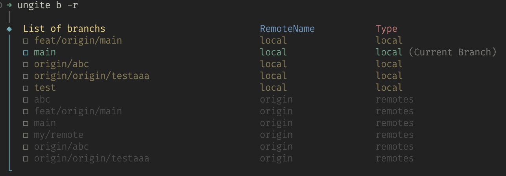

# ungite [](https://npmjs.com/package/ungite)

Git management Viewable.

## Features
- 🔥 Simple operation git flow.

## Usage
```shell
pnpm i -g ungite
```

```shell
ungite -h
```

### Branch

列出所有本地分支：

```shell
ungite b
```



#### Options
- 列出所有分支
- `-r` 列出所有分支 (包括远程分支)
- `-s` 切换目标分支
- `-d` 删除目标分支 (支持多选)

### Remote

查看当前仓库的 remote 名称及 fetch/push 地址（与 `git remote -v` 一致）：

```shell
ungite r
```

进入交互式删除模式，使用空格多选、回车执行、Ctrl+C 取消：

```shell
ungite r -d
```

- `origin` 显示为禁用项，不可选择或删除。
- 每个 remote 只显示一个选项，移除时执行 `git remote remove <name>`。
- 删除仅移除本地仓库的 remote 配置及相关远程跟踪引用，不删除远程仓库。

## License

[MIT](./LICENSE) License © 2023 [zyyv](https://github.com/zyyv)
